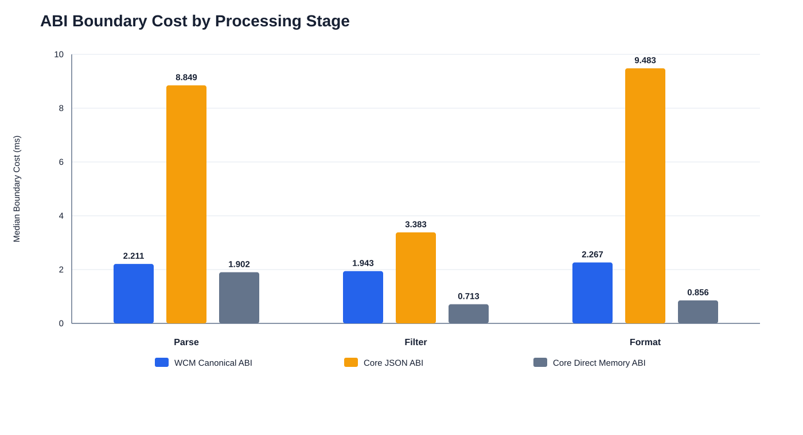
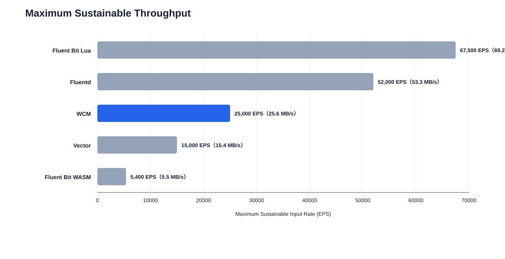
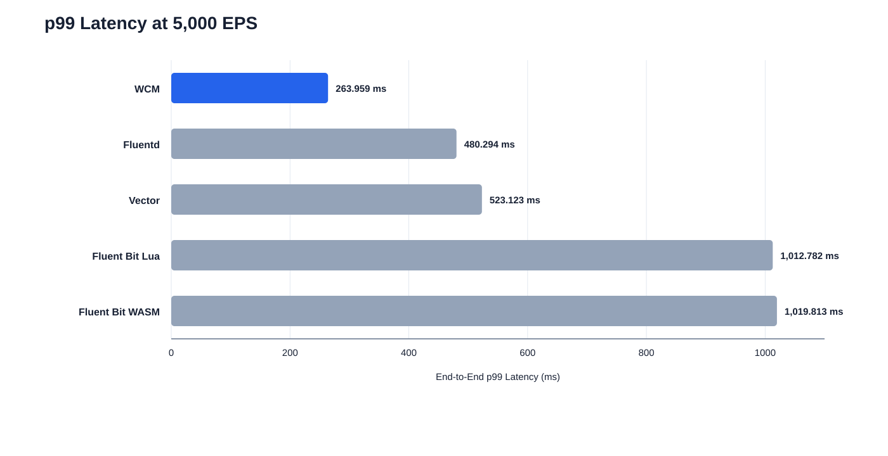

# RQ2 精簡圖表與說明

## 圖一：WCM與Core Wasm的邊界成本

**實驗內容：** 使用1024筆、約1 MiB的輸入，比較WCM Canonical ABI、Core JSON ABI與Core Direct Memory ABI在Parse、Filter及Format階段的資料輸入與輸出成本。圖中僅呈現copy-in加copy-out，不包含Guest業務邏輯，數值越低越好。

**本系統表現：** WCM在Parse、Filter與Format的邊界成本分別為2.211、1.943與2.267 ms，均低於JSON ABI的8.849、3.383與9.483 ms，但仍高於Direct Memory ABI。結果顯示WCM能避免JSON序列化的大部分成本，但標準化型別轉換仍會付出比低階Direct ABI更高的代價。

## 圖二：1024 Bytes多欄位日誌的最大可持續吞吐量

**實驗內容：** 使用1024 Bytes、36欄位JSON日誌，在1 CPU、512 MiB、單一TCP連線及相同Filter規則下，量測各系統的最大可持續輸入速率。數值越高越好。

**本系統表現：** WCM可持續處理25,000 EPS，排名第三，高於Vector的15,000 EPS及Fluent Bit WASM的5,400 EPS，但低於Fluentd的52,000 EPS與Fluent Bit Lua的67,500 EPS。結果顯示WCM具有可用的中等吞吐能力，但跨元件資料交換與多階段Wasm處理仍帶來額外成本。

## 圖三：相同5,000 EPS下的p99延遲

**實驗內容：** 在五個配置皆能穩定執行的5,000 EPS共同負載下，比較1024 Bytes、36欄位日誌的p99端到端延遲。數值越低越好。

**本系統表現：** WCM的p99延遲為263.959 ms，低於Fluentd的480.294 ms、Vector的523.123 ms、Fluent Bit Lua的1,012.782 ms及Fluent Bit WASM的1,019.813 ms。結果顯示WCM在低至中負載下具有較低延遲；但此圖不表示WCM的CPU用量最低，且各產品內部batch實作仍存在差異。

## 使用方式

正文建議依序放置圖一至圖三，分別回答「WCM付出多少邊界成本」、「整體系統可處理多少流量」及「相同負載下延遲如何」。完整的多資料大小與EPS sweep折線圖可移至附錄，避免正文圖表包含過多曲線。
