# 現有實驗、腳本與結果索引

本文件整理目前已完成或保留結果的比較實驗，列出實驗內容、執行腳本、結果位置與圖表。依要求，**不包含五分鐘持續過載恢復實驗**；短時間 5／15／30 秒突發恢復仍保留，因其目標是短突發吸收能力而非持續過載。

## 1. 快速索引

| 實驗 | 狀態 | 主要腳本 | 主要結果 | 圖表 |
|---|---|---|---|---|
| 160 B 歷史容量與各自 80% 負載延遲 | 已完成；歷史輔助資料 | `capacity/capacity.sh`、`capacity/search.sh` | `實驗結果.csv`、`capacity/runs/RESULTS.md` | `results/experiment_catalog_charts/01_legacy_160b_capacity_latency.svg` |
| 128–2048 B 多欄位最大吞吐量 | 已完成 | `capacity/capacity.sh`、`capacity/search.sh` | `results/multifield_capacity_256_2048.csv` | `results/multifield_capacity_256_2048.svg` |
| 1024 B／36 欄位負載－延遲與資源曲線 | 已完成 | 五個 `capacity/run_*_fields1k_latency*.sh` | `results/*_fields1k_latency_*.csv` | `results/five_product_latency_charts/*.svg` |
| WCM 正確性 | 已完成 | `correctness/run_wcm_correctness.sh` | `correctness/runs/wcm_correctness_*_20260804/` | `results/experiment_catalog_charts/02_wcm_correctness.svg` |
| 四產品短突發恢復 | 已完成；每情境一輪 | `resilience/run_*_burst.sh` | `resilience/runs/*_burst_forward30_formal_*/` | `results/experiment_catalog_charts/03_short_burst_recovery.svg` |
| WCM 一小時 80% 容量穩定性 | 已完成；手動一輪 | `resilience/run_wcm_stability.sh` | `resilience/runs/wcm_stability_20k_1h_manual_r1_20260809/` | `results/experiment_catalog_charts/04_wcm_one_hour_stability.svg` |
| 舊版故障注入／crash 診斷 | 部分完成，不屬正式公平比較 | 各產品 `script/run_crash.sh` | 各產品 `stats_*.csv` 與診斷圖片 | 見第 8 節 |

## 2. 160 B 歷史容量與各自 80% 負載延遲

### 實驗名稱

固定約 160 B、五種訊息循環 workload 的最大可持續吞吐量搜尋，以及各產品自身最大吞吐量 80% 工作點的延遲量測。

### 實驗內容

- 產品：WCM、Fluentd、Vector、Fluent Bit Lua、Fluent Bit WASM。
- 資源：1 CPU、512 MiB、無 swap、單 TCP 連線、單 output worker。
- 管線：JSON parse → 保留 warn／error（40%）→ HTTP sink。
- 容量判定：generator 達成率、send lag、backlog、sink 實收與 OOM。
- 延遲結果是在各產品自己的 80% 最大吞吐量量測，**不是相同 EPS**，不可當成等負載排名。
- 這批是歷史輔助資料，部分 run 沒有保存 image digest 或 container-scope CPU／MEM，不應取代後續 1024 B／36 欄位正式比較。

### 實驗腳本

- 單點執行器：`capacity/capacity.sh`
- 最大吞吐量搜尋：`capacity/search.sh`
- 絕對 EPS／tuned matrix：`capacity/matrix.sh`
- 結果重建：`results/build_results_csv.py`

### 結果儲存位置

- 統一機器可讀資料：`../../實驗結果.csv`
- 歷史總結：`capacity/runs/RESULTS.md`
- 原始容量／延遲資料：`capacity/runs/<product>/cap_rate_*`、`capacity/runs/<product>/lat_rate_*`
- 搜尋結果：`capacity/runs/<product>/search_result*.txt`

### 結果摘要

| 產品 | 確認容量 | 輸入吞吐 | 80% 工作點 p99 |
|---|---:|---:|---:|
| Fluent Bit Lua | 288,000 EPS | 45.989 MB/s | 1,003.832 ms |
| Fluentd | 152,000 EPS | 24.273 MB/s | 1,006.651 ms |
| WCM | 136,000 EPS | 21.708 MB/s | 141.727 ms |
| Vector | 66,000 EPS | 10.537 MB/s | 1,091.151 ms |
| Fluent Bit WASM | 28,000 EPS | 4.474 MB/s | 1,014.470 ms |

### 結果圖表

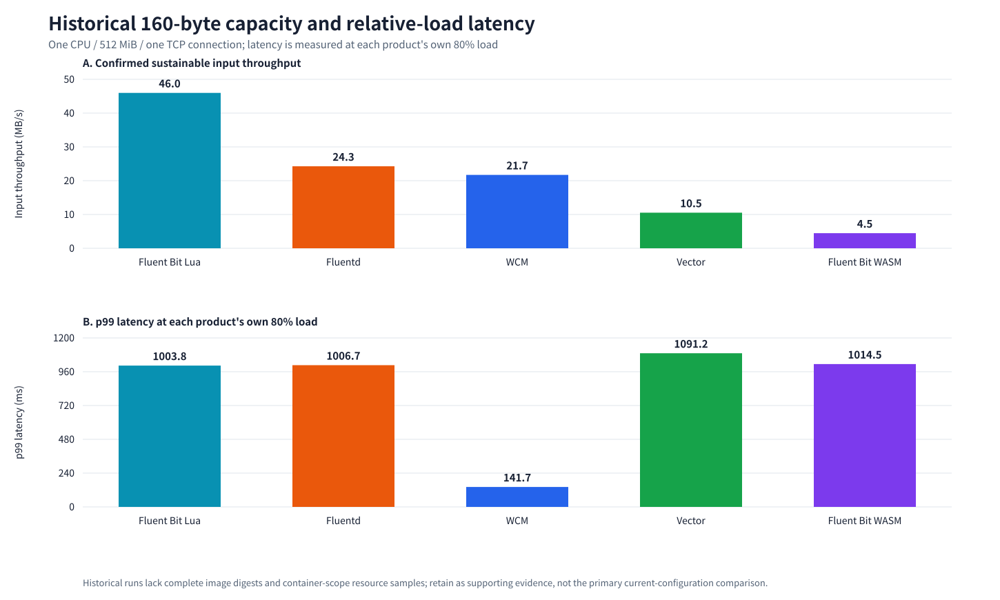

## 3. 128–2048 B 多欄位最大吞吐量

### 實驗名稱

五產品多欄位 JSON 容量曲線。

### 實驗內容

- JSON 大小：128、256、512、768、1024、1536、2048 B。
- 欄位數隨大小增加：4、8–9、17–18、27、36、54、72 個 top-level 欄位。
- 共同條件：1 CPU、512 MiB、單 TCP 連線、1 秒 flush、單 output worker、retry 關閉。
- 每一容量點以 generator 達成率、send lag、backlog、實收筆數與 OOM 共同判定。
- 此曲線同時改變 bytes 與 fields，因此表示綜合成本；不能只由這組數據分離 per-byte 與 per-field 因果。

### 實驗腳本

- 單點容量執行：`capacity/capacity.sh`
- 搜尋控制：`capacity/search.sh`
- 結果圖：`results/plot_multifield_capacity.py`
- 個別大小的 probe／confirm run 由 `capacity.sh` 搭配 `GEN_MODE`、`RUN_VARIANT`、目標 EPS 執行，沒有另一支獨立總控 sweep 腳本。

### 結果儲存位置

- 正式結果 CSV：`results/multifield_capacity_256_2048.csv`
- 分析：`results/multifield_capacity_analysis.md`
- 原始 run：`capacity/runs/<product>/cap_rate_*_fields*`
- 產生器與 sink 原始資料均位於各 run 子目錄。
- WCM 1024 B 正式點已改用 2026-08-09 手動重測：
  `capacity/runs/wcm-b1/cap_rate_25000_fields1k_capacity_manual_r{1,2,3}_20260809`。
  25,000 EPS 三輪皆 PASS；相鄰上界
  `cap_rate_25500_fields1k_capacity_manual_r{1,2,3}_20260809` 三輪皆 FAIL。
- Fluentd 1024 B 正式點已改用 2026-08-09 手動重測：
  `capacity/runs/fluentd/cap_rate_52000_fields1k_capacity_manual_r{1,2,3}_20260809`。
  52,000 EPS 三輪皆 PASS；
  `cap_rate_52500_fields1k_capacity_manual_r{1,2,3,4}_20260809` 為兩輪 PASS、
  兩輪 FAIL，因此定義為首個不穩定點。
- Fluent Bit Lua 1024 B 正式點已改用 2026-08-09 手動重測：
  `capacity/runs/fbit-lua/cap_rate_67500_fields1k_capacity_manual_r{1,2,3}_20260809`。
  67,500 EPS 三輪皆 PASS；
  `cap_rate_68000_fields1k_capacity_manual_r1_20260809` 為首個 FAIL 點。
- Vector 1024 B 正式點已改用 2026-08-09 手動重測：
  `capacity/runs/vector/cap_rate_15000_fields1k_capacity_manual_r{1,2,3}_20260809`。
  15,000 EPS 三輪皆 PASS；
  `cap_rate_15500_fields1k_capacity_manual_r1_20260809` 為首個 FAIL 點。
- Fluent Bit WASM 1024 B 正式點已改用 2026-08-09 手動重測：
  `capacity/runs/fbit-wasm/cap_rate_5400_fields1k_capacity_manual_r{1,2,3}_20260809`。
  5,400 EPS 三輪皆 PASS；
  `cap_rate_5500_fields1k_capacity_manual_r{1,2,3}_20260809` 為兩輪 PASS、
  一輪 FAIL，因此定義為首個不穩定點。

### 結果摘要（MB/s）

| 大小 | FB Lua | Fluentd | WCM | Vector | FB WASM |
|---:|---:|---:|---:|---:|---:|
| 128 B | 41.021 | 26.315 | 20.898 | 10.707 | 4.128 |
| 256 B | 53.969 | 35.491 | 23.129 | 14.392 | 4.883 |
| 512 B | 64.124 | 34.627 | 23.700 | 15.390 | 5.386 |
| 768 B | 66.133 | 48.446 | 24.992 | 15.380 | 5.306 |
| 1024 B | 69.186 | 53.299 | 25.624 | 15.375 | 5.535 |
| 1536 B | 66.397 | 52.718 | 24.591 | 14.601 | 5.226 |
| 2048 B | 65.566 | 54.297 | 24.587 | 13.523 | 5.020 |

### 結果圖表

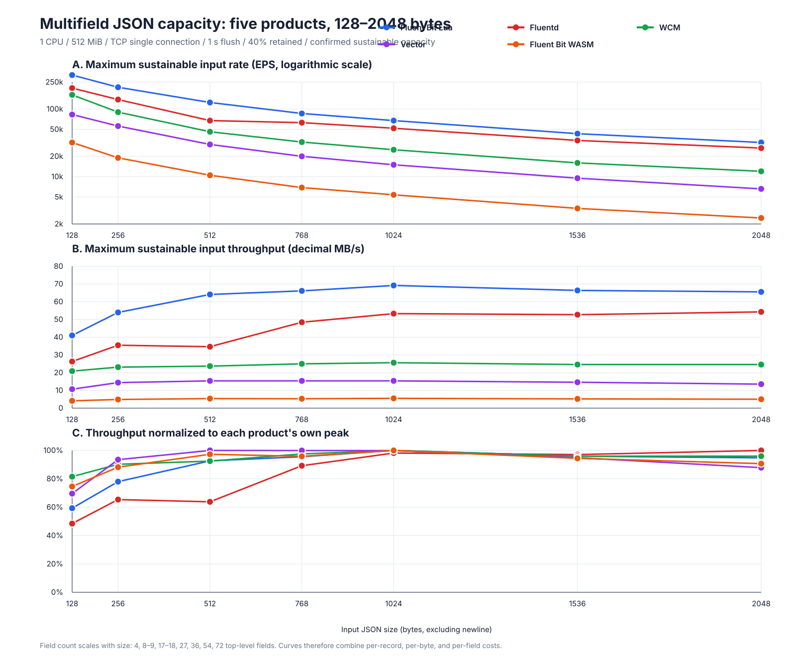

## 4. 1024 B／36 欄位負載－延遲與資源曲線

### 實驗名稱

五產品 1024 B 多欄位 JSON 的 EPS－延遲、CPU 與記憶體 sweep。

### 實驗內容

- 每個 EPS 階段執行 180 秒，取 30–150 秒穩態窗。
- 延遲：p50、p90、p95、p99、p99.9。
- 資源：DUT container cgroup CPU mean／max 與 memory mean／max。
- 固定 1 CPU、512 MiB、單連線、單 worker／concurrency、相同 1024 B／36 欄位資料與 filter。
- 各產品由 2,500 EPS 開始提高，直到第一個 FAIL；PASS／FAIL 同時考慮 throughput deficit 與排隊延遲。

### 實驗腳本

- WCM 正式 cgroup 重測：`capacity/run_wcm_fields1k_latency_cgroup_rerun.sh`
- WCM 早期 sweep：`capacity/run_wcm_fields1k_latency_sweep.sh`
- Vector：`capacity/run_vector_fields1k_latency_cgroup_sweep.sh`
- Fluentd：`capacity/run_fluentd_fields1k_latency_sweep.sh`
- Fluent Bit Lua：`capacity/run_fbit_lua_fields1k_latency_cgroup_sweep.sh`
- Fluent Bit WASM：`capacity/run_fbit_wasm_fields1k_latency_cgroup_sweep.sh`
- 共同底層執行器：`capacity/capacity.sh`
- 五產品繪圖：`capacity/plot_five_product_latency_comparison.py`

### 結果儲存位置

- 彙整 CSV／Markdown：`results/*_fields1k_latency_*.csv`、`results/*_fields1k_latency_*.md`
- 子窗口資料：`results/*_fields1k_latency_*subwindows.csv`
- 原始資料：`capacity/runs/<product>/lat_rate_*_fields1k_latency_*`
- 每個 run 內含 `latency_worker_1.csv`、`stats.csv`、延遲與資源摘要。

### 結果摘要

| 產品 | 最高 PASS | 第一個 FAIL | 接近上限的 CPU mean | 接近上限的 memory mean |
|---|---:|---:|---:|---:|
| Fluent Bit Lua | 65,000 EPS | 70,000 EPS | 91.156% | 35.188 MiB |
| Fluentd | 45,000 EPS | 50,000 EPS | 90.256% | 127.489 MiB |
| WCM | 22,250 EPS | 22,500 EPS | 95.389% | 28.449 MiB |
| Vector | 15,250 EPS | 15,500 EPS | 97.837% | 37.451 MiB |
| Fluent Bit WASM | 5,500 EPS | 5,600 EPS | 99.127% | 282.923 MiB |

### 結果圖表

#### p50 與 p99 延遲

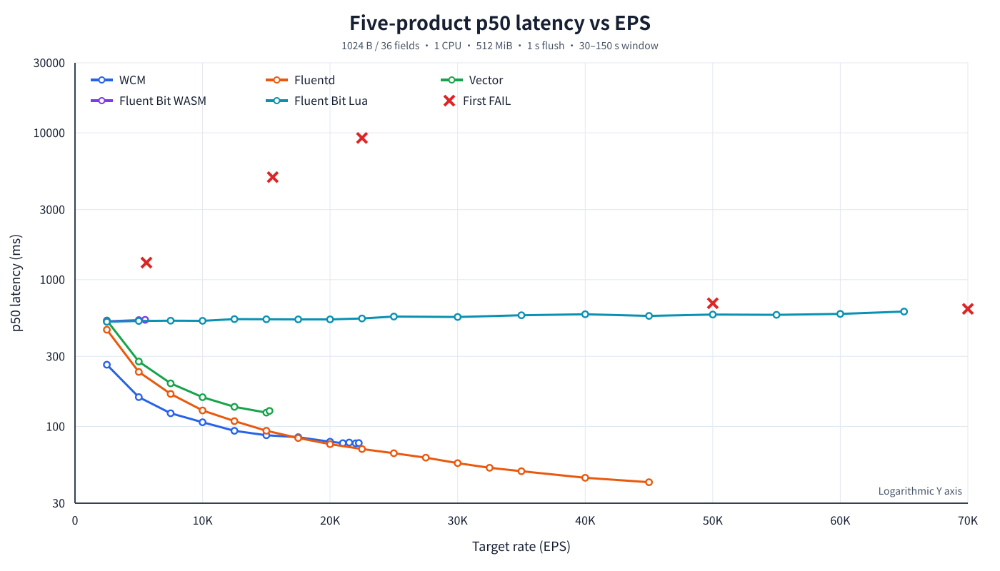

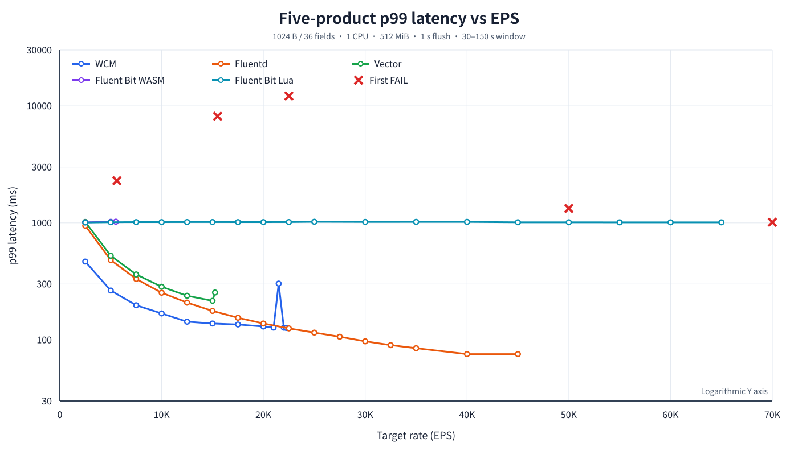

#### CPU 與記憶體

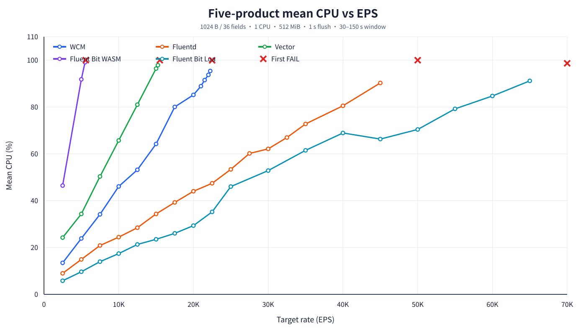

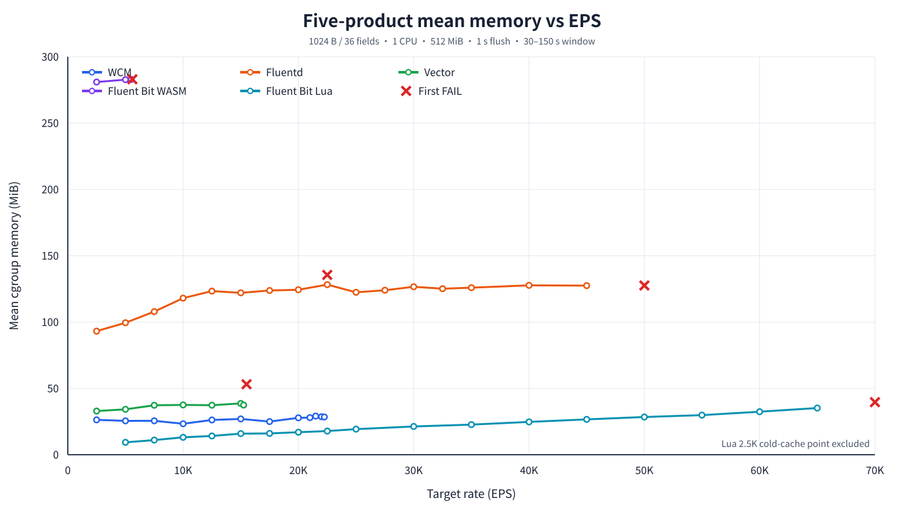

## 5. WCM 正確性

### 實驗名稱

WCM 過濾、轉換與輸出資料正確性驗證。

### 實驗內容

- C1：2,500 EPS 合法資料。
- C2：17,500 EPS 合法資料。
- C3：固定 5% malformed JSON，用來觀察錯誤隔離行為。
- C4：boolean、integer、float、null、Unicode、引號與反斜線 edge values。
- 每個正式情境三輪；逐筆驗證 missing、duplicate、corrupt、unexpected、reorder 與 bad JSON。
- 1024 B／36 欄位、1 CPU、512 MiB、1 MiB batch、1 秒 max wait、單 TCP 與 HTTP worker。

### 實驗腳本

- 執行器：`correctness/run_wcm_correctness.sh`
- 評估器：`correctness/evaluate.py`
- 彙整器：`correctness/summarize.py`
- 來源：`correctness/generator/main.go`
- 驗證 sink：`correctness/validationsink/main.go`

### 結果儲存位置

- C1–C3：`correctness/runs/wcm_correctness_formal_20260804/`
- C4：`correctness/runs/wcm_correctness_edge_20260804/`
- 各目錄含 `summary.csv`、`summary.md` 與每輪 generator／sink／stats／container state。

### 結果摘要

| 情境 | 通過 | 預期輸出 | 實際輸出 | 遺失 | 主要結論 |
|---|---:|---:|---:|---:|---|
| C1 | 3/3 | 120,000 | 120,000 | 0 | 低負載合法資料完全正確 |
| C2 | 3/3 | 1,200,000 | 1,200,000 | 0 | 高負載合法資料完全正確 |
| C3 | 0/3 | 114,000 | 0 | 114,000 | 任一 malformed record 使整個 contaminated batch 被丟棄 |
| C4 | 3/3 | 120,000 | 120,000 | 0 | 特殊型別與 escape 值完全正確 |

所有輪次均無 OOM；C3 是明確觀察到的 batch-level error isolation 缺陷，不應改寫為通過。

### 結果圖表

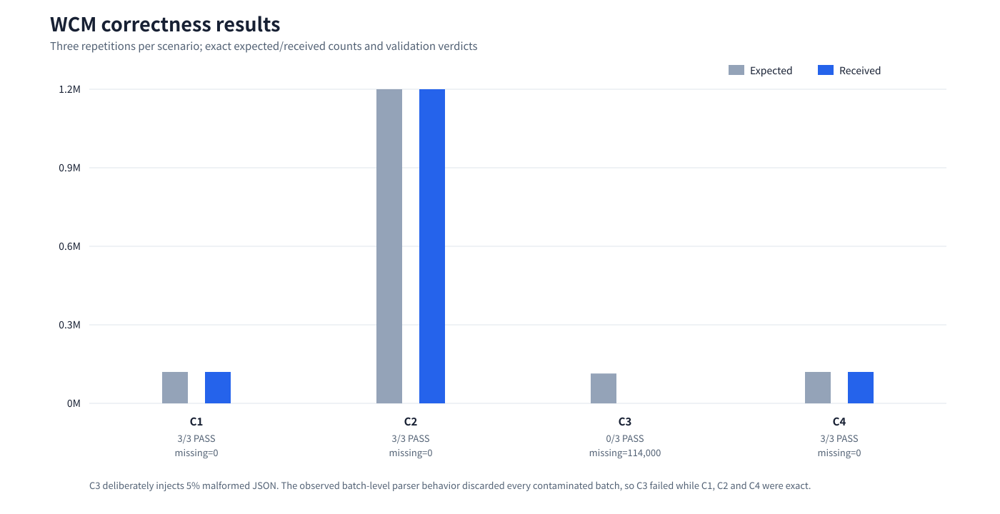

## 6. 四產品短時間突發恢復

### 實驗名稱

各產品承受自身最大吞吐量 150% 的 5／15／30 秒短突發後，回到 50% M baseline 的恢復能力。

### 實驗內容

- 產品：WCM、Vector、Fluentd、Fluent Bit WASM。
- 1024 B／36 欄位、1 CPU、512 MiB、單 TCP 來源與單 HTTP worker。
- B1／B2／B3：150% M 持續 5／15／30 秒。
- 恢復門檻：forward interval 回到自身 baseline p99 門檻，並完成連續 30 秒穩態確認。
- 驗證資料正確性、output backlog、source pending、CPU、記憶體與 OOM。
- 每項情境目前只有一輪，因此只能報告觀察趨勢，不能宣稱統計顯著。

### 實驗腳本

- WCM：`resilience/run_wcm_burst.sh`
- Vector：`resilience/run_vector_burst.sh`
- Fluentd：`resilience/run_fluentd_burst.sh`
- Fluent Bit WASM：`resilience/run_fbit_wasm_burst.sh`
- 恢復分析：`resilience/analyze_burst_forward30.py`
- 彙整：`resilience/summarize_burst.py`
- WCM 時間軸圖：`resilience/plot_burst_results.py`

同一組 runner 也能執行持續過載，但本節只列出 `B1/B2/B3 = 5/15/30 秒`的短突發正式結果，不包含五分鐘 overload run。

### 結果儲存位置

- WCM：`resilience/runs/wcm_burst_forward30_formal_20260805/`
- Vector：`resilience/runs/vector_burst_forward30_formal_20260805/`
- Fluentd：`resilience/runs/fluentd_burst_forward30_formal_20260805/`
- Fluent Bit WASM：`resilience/runs/fbit_wasm_burst_forward30_formal_20260806/`
- 每個根目錄的 `summary.csv` 是跨情境彙整；`B*_rep1/` 保存逐秒資料與驗證結果。
- 完整文字分析：`resilience/result.md` 第 1–12 節。

### 結果摘要：恢復時間

| 產品 | 5 秒 burst | 15 秒 burst | 30 秒 burst | 資料錯誤／OOM |
|---|---:|---:|---:|---:|
| WCM | 6.194 s | 15.133 s | 53.086 s | 0／0 |
| Vector | 6.108 s | 36.110 s | 70.991 s | 0／0 |
| Fluentd | 6.075 s | 18.789 s | 38.045 s | 0／0 |
| Fluent Bit WASM | 9.874 s | 22.075 s | 33.069 s | 0／0 |

此處「恢復」是回到各產品自己的 baseline，而非相同絕對延遲。Fluent Bit WASM 約一秒 baseline p99，因此它在 30 秒 burst 的相對恢復較快，不代表絕對延遲比 WCM 或 Fluentd 低。

### 結果圖表

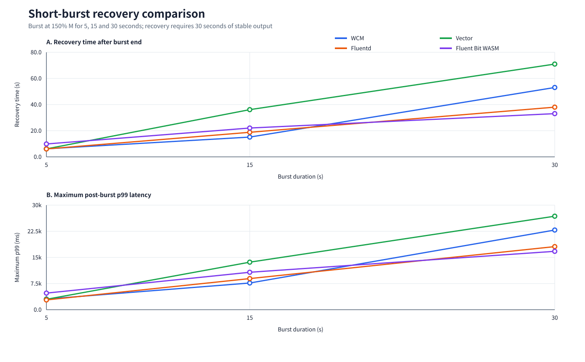

WCM 的逐秒延遲、吞吐、queue 與資源圖另存於：

- `resilience/runs/wcm_burst_formal_20260804/figures/01_latency_timeline.svg`
- `resilience/runs/wcm_burst_formal_20260804/figures/02_throughput_timeline.svg`
- `resilience/runs/wcm_burst_formal_20260804/figures/03_queue_timeline.svg`
- `resilience/runs/wcm_burst_formal_20260804/figures/04_burst_summary.svg`
- `resilience/runs/wcm_burst_formal_20260804/figures/05_resource_summary.svg`

## 7. WCM 一小時 80% 容量穩定性

### 實驗名稱

WCM 在最大吞吐量 80% 工作點的一小時持續穩定性與資源漂移測試。

### 實驗內容

- 1024 B／36 欄位、20,000 input EPS（手動容量 25,000 EPS 的 80%）、
  預期 filter 後 8,000 output EPS。
- Warm-up 180 秒，正式 steady window 3,600 秒，final drain 120 秒。
- 1 CPU、512 MiB、無 swap。
- 觀察實際吞吐、資料正確性、p99／p99.9、CPU、RSS 漂移、OOM 與重啟。

### 實驗腳本

- 執行器：`resilience/run_wcm_stability.sh`
- 分析器：`resilience/analyze_stability.py`
- 本索引圖表：`results/plot_experiment_catalog.py`

### 結果儲存位置

- Run 根目錄：`resilience/runs/wcm_stability_20k_1h_manual_r1_20260809/`
- 正式分析：`resilience/runs/wcm_stability_20k_1h_manual_r1_20260809/S1_rep1/stability_analysis.json`
- 逐秒輸出與延遲：`S1_rep1/sink_per_sec.csv`
- 逐秒 CPU／RSS：`S1_rep1/stats.csv`
- 產生器與資料驗證：`S1_rep1/generator_summary.json`、`S1_rep1/validation_summary.json`
- 文字分析：`resilience/result.md` 第 14 節。

### 結果摘要

| 指標 | 結果 |
|---|---:|
| 預期／實際輸出 | 30,240,000／30,240,000 |
| 遺失／重複／內容錯誤／亂序 | 0／0／0／0 |
| p50 中位數 | 84.194 ms |
| p99 中位數／最大值 | 111.665／167.891 ms |
| 首／末 5 分鐘 p99 | 110.894／112.038 ms |
| CPU mean／max | 83.844／101.90% |
| RSS mean／max | 48.437／52.09 MiB |
| 首末 RSS 差／線性估計 | +0.496 MiB／+0.387 MiB/hour |
| OOM／重啟 | 0／0 |

一小時內沒有延遲持續惡化、單調 RSS 成長、資料錯誤、OOM 或重啟；
但單一一小時輪次仍不能取代 8 或 24 小時長期穩定性測試。

### 結果圖表

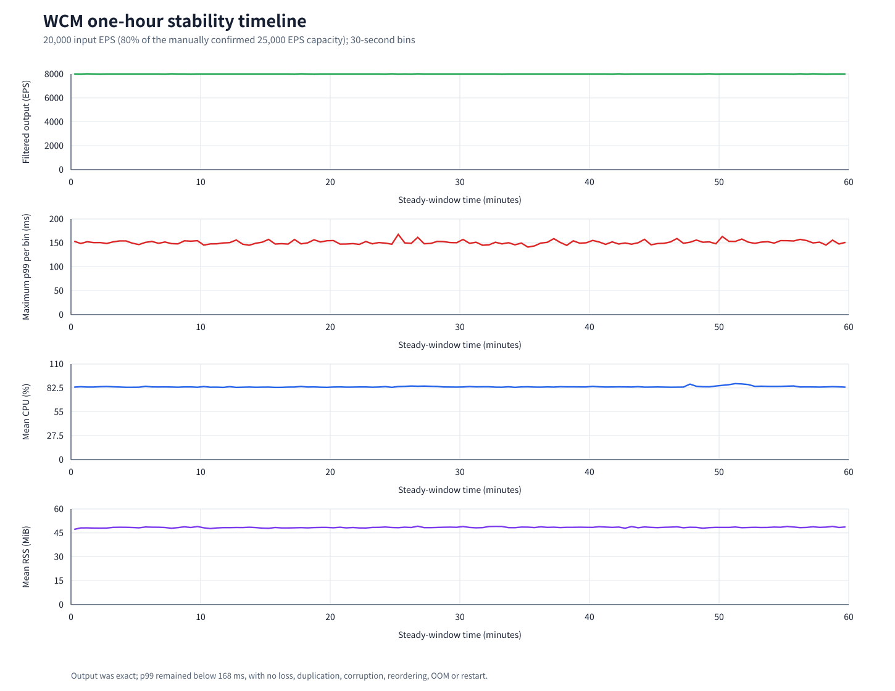

## 8. 舊版故障注入／crash 診斷資料（部分完成）

這些檔案測試自訂 filter 出現 CPU exhaustion、memory exhaustion、I/O blocking 或 loop 時的行為。它們的版本、輸入方式、採樣範圍與正式 capacity／latency 實驗沒有完整對齊，目前應視為診斷性資料，不納入五產品正式排名。

### 實驗腳本

- Vector：`vector/script/run_crash.sh`
- Fluentd：`fluentd/script/run_crash.sh`
- Fluent Bit Lua：`fluentbit/lua/script/run_crash.sh`
- Fluent Bit WASM：`fluentbit/wasm_filter/script/run_crash.sh`

### 結果儲存位置

- Vector：`vector/stats_cpu.csv`、`vector/stats_mem.csv`、`vector/stats_io.csv`、`vector/stats_loop.csv` 及對應 `*_sink.csv`
- Fluentd：`fluentd/stats_cpu.csv`、`fluentd/stats_mem.csv`、`fluentd/stats_io.csv`、`fluentd/stats_loop.csv` 及對應 sink CSV
- Fluent Bit Lua：`fluentbit/lua/stats_*.csv` 與 `stats_*_sink.csv`
- Fluent Bit WASM：`fluentbit/wasm_filter/stats_*.csv` 與 `stats_*_sink.csv`

### 現有診斷圖片

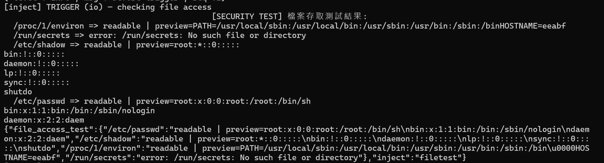

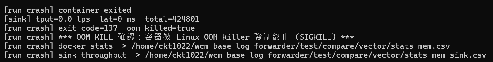

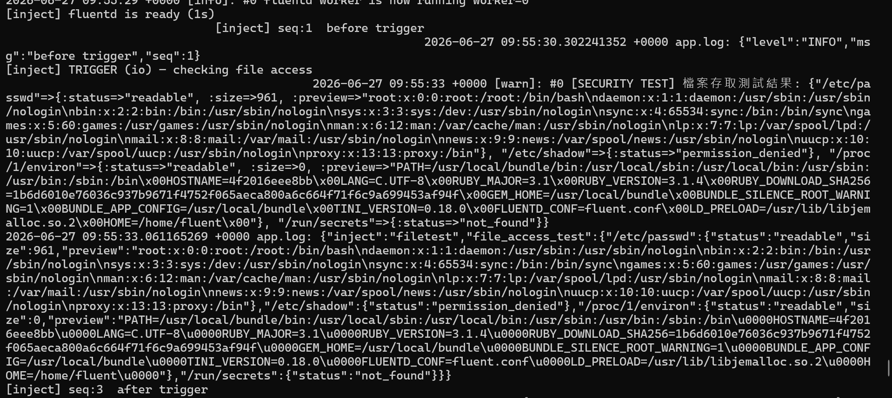

目前沒有一份共同判定準則下的完整四／五產品 fault-isolation summary；若要寫入論文主結果，應重新統一 workload、容器資源、故障開始時間、survival／restart／recovery 判定及資料正確性驗證。

## 9. 未執行與本文件刻意排除的項目

### Absolute-load latency 計畫

`absolute_load/` 只有計畫與容量彙整，README 明確標示尚未執行；`experiment_plan.csv` 的 runnable rows 仍為 `PENDING`。因此本文件不把它列成已有實驗結果，也沒有製作結果圖。

### 五分鐘持續過載恢復

依本次整理要求，以下 `resilience/runs/*overload*` 結果及其比較不收錄在本文件：

- WCM 五分鐘持續過載各輪。
- Vector 五分鐘持續過載各輪。
- Fluentd 五分鐘持續過載各輪。
- Fluent Bit WASM 五分鐘持續過載輪次。

這些資料仍保留於 `resilience/runs/`，文字分析仍保留於 `resilience/result.md` 第 13、15 節，但不屬於本索引的內容範圍。

## 10. 圖表重建

以下指令只讀取現有結果並重新產生圖表，不會執行負載測試：

```bash
python3 test/compare/results/plot_multifield_capacity.py
python3 test/compare/capacity/plot_five_product_latency_comparison.py
python3 test/compare/results/plot_experiment_catalog.py
```

所有新補圖均位於 `test/compare/results/experiment_catalog_charts/`。

## 11. 完整實驗腳本清單

本節用來核對 `test/compare/` 內目前所有 `.sh`、主要 `.py` 及實驗用 `main.go`。標記為「正式」者可用於目前論文主線；「歷史」者使用舊流程或舊量測範圍；「輔助」者不直接產生負載；「未執行」者目前只有計畫。

### 11.1 容量與延遲共同執行層

| 類型 | 腳本 | 用途 |
|---|---|---|
| 正式共同runner | `capacity/capacity.sh` | 執行單一產品、單一EPS的capacity或latency點 |
| 正式搜尋 | `capacity/search.sh` | 倍增粗掃、二分收斂及容量點確認重跑 |
| 歷史／tuned matrix | `capacity/matrix.sh` | 相同絕對EPS下搜尋各產品可用flush設定 |
| 輔助判定 | `capacity/eval_trial.py` | 判定capacity單點PASS／FAIL |
| 輔助延遲計算 | `capacity/calc_latency_stream.py` | 由sink原始CSV計算指定時間窗延遲 |
| 輔助sink | `capacity/httpsink/main.go` | HTTP接收、延遲與實收資料收集 |
| 輔助sink | `capacity/tcpsink/main.go` | TCP診斷接收端 |
| 正式資源採樣 | `sample_cgroup_stats.sh` | 容器cgroup CPU與memory採樣 |
| 歷史資源採樣 | `sample_stats.sh` | 舊版process範圍採樣；不可與cgroup結果混用 |

### 11.2 1024 B／36欄位正式延遲sweep

| 產品 | 執行腳本 | 分析／彙整腳本 |
|---|---|---|
| WCM | `capacity/run_wcm_fields1k_latency_cgroup_rerun.sh` | `capacity/analyze_wcm_latency_cgroup_windows.py`、`capacity/summarize_wcm_fields1k_latency_cgroup.py` |
| WCM舊輪 | `capacity/run_wcm_fields1k_latency_sweep.sh` | `capacity/analyze_wcm_latency_windows.py`、`capacity/summarize_wcm_fields1k_latency.py` |
| Vector | `capacity/run_vector_fields1k_latency_cgroup_sweep.sh` | `capacity/analyze_vector_latency_cgroup_windows.py`、`capacity/summarize_vector_fields1k_latency_cgroup.py` |
| Fluentd | `capacity/run_fluentd_fields1k_latency_sweep.sh` | `capacity/analyze_fluentd_latency_windows.py`、`capacity/summarize_fluentd_fields1k_latency.py` |
| Fluent Bit Lua | `capacity/run_fbit_lua_fields1k_latency_cgroup_sweep.sh` | `capacity/analyze_fbit_lua_latency_cgroup_windows.py`、`capacity/summarize_fbit_lua_fields1k_latency_cgroup.py` |
| Fluent Bit WASM | `capacity/run_fbit_wasm_fields1k_latency_cgroup_sweep.sh` | `capacity/analyze_fbit_wasm_latency_cgroup_windows.py`、`capacity/summarize_fbit_wasm_fields1k_latency_cgroup.py` |

共同繪圖與產品單圖腳本：

- `capacity/plot_five_product_latency_comparison.py`
- `capacity/plot_fluentd_fields1k_latency.py`
- `results/plot_fluentd_fields1k_latency.py`
- `results/plot_wcm_fields1k_latency.py`

從repository根目錄逐一重跑的指令：

```bash
bash test/compare/capacity/run_wcm_fields1k_latency_cgroup_rerun.sh
bash test/compare/capacity/run_vector_fields1k_latency_cgroup_sweep.sh
bash test/compare/capacity/run_fluentd_fields1k_latency_sweep.sh
bash test/compare/capacity/run_fbit_lua_fields1k_latency_cgroup_sweep.sh
bash test/compare/capacity/run_fbit_wasm_fields1k_latency_cgroup_sweep.sh
```

這些腳本預設會沿用固定的run variant名稱；重跑前應先確認是否會覆蓋既有目錄。若只驗證關鍵點，優先使用腳本支援的 `RATES_OVERRIDE`，或Fluentd的 `START_RATE`／`STEP`／`MAX_RATE`，避免重跑全部點。

### 11.3 128–2048 B多欄位容量

目前沒有一支包住五產品、七種大小的正式總控腳本。實際測量使用：

- `capacity/capacity.sh`
- `capacity/search.sh`
- `capacity/eval_trial.py`
- `results/plot_multifield_capacity.py`

結果整理使用：

- `results/build_results_csv.py`
- `make_summary.py`
- `results/plot_experiment_catalog.py`

單一容量點的通用形式為：

```bash
GEN_MODE=<對應大小的generator模式> \
RUN_VARIANT=<唯一結果名稱> \
bash test/compare/capacity/capacity.sh <dut> <target_eps> cap
```

因各大小的正式點是以probe／upper／confirm方式逐點找出，重做前應先從 `results/multifield_capacity_256_2048.csv` 取得現有PASS與first-fail，直接驗證這兩個鄰近點，不必重新從低速率搜尋。

### 11.4 WCM正確性

完整腳本與來源：

- `correctness/run_wcm_correctness.sh`
- `correctness/evaluate.py`
- `correctness/summarize.py`
- `correctness/generator/main.go`
- `correctness/validationsink/main.go`

正式四情境三輪重跑：

```bash
RUN_ID=wcm_correctness_manual_r1 \
REPEATS=3 \
SCENARIOS='C1 C2 C3 C4' \
bash test/compare/correctness/run_wcm_correctness.sh
```

### 11.5 短突發、持續過載與穩定性

四產品burst／overload共用runner：

- `resilience/run_wcm_burst.sh`
- `resilience/run_vector_burst.sh`
- `resilience/run_fluentd_burst.sh`
- `resilience/run_fbit_wasm_burst.sh`

分析、彙整及繪圖：

- `resilience/analyze_burst.py`：早期恢復判定。
- `resilience/analyze_burst_forward30.py`：目前正式30秒forward interval判定。
- `resilience/summarize_burst.py`
- `resilience/plot_burst_results.py`

WCM穩定性：

- `resilience/run_wcm_stability.sh`
- `resilience/analyze_stability.py`

五分鐘持續過載的共同參數如下；本文件仍不收錄其結果，但保留重跑方式：

```bash
env \
  RUN_ID=<唯一run名稱> \
  REPEATS=1 \
  SCENARIOS=B3 \
  B3_BURST_SECS=300 \
  WARM_SECS=180 \
  BASELINE_SECS=120 \
  RECOVERY_SECS=900 \
  DRAIN_SECS=120 \
  BASELINE_RATE=<見下表> \
  BURST_RATE=<見下表> \
  LOG_FIRST_PER_BATCH=false \
  ANALYZER_SCRIPT=/home/ckt1022/wcm-base-log-forwarder/test/compare/resilience/analyze_burst_forward30.py \
  bash <見下表runner>
```

| 產品 | Baseline | Burst | runner |
|---|---:|---:|---|
| WCM | 11,125 | 33,375 | `test/compare/resilience/run_wcm_burst.sh` |
| Vector | 7,625 | 22,875 | `test/compare/resilience/run_vector_burst.sh` |
| Fluentd | 25,000 | 75,000 | `test/compare/resilience/run_fluentd_burst.sh` |
| Fluent Bit WASM | 2,750 | 8,250 | `test/compare/resilience/run_fbit_wasm_burst.sh` |

WCM一小時穩定性重跑：

```bash
RUN_ID=wcm_stability_20k_1h_manual_r1_20260809 \
RATE=20000 \
WARM_SECS=180 \
STEADY_SECS=3600 \
DRAIN_SECS=120 \
bash test/compare/resilience/run_wcm_stability.sh
```

### 11.6 歷史產品專用latency／throughput腳本

以下腳本屬於較早期流程，輸入、資源採樣或設定未必與目前正式cgroup sweep一致。它們保留供追溯，不建議直接混入目前主表：

- `fluentd/latency/latency.sh`
- `fluentd/latency/latency_80%.sh`
- `fluentd/latency/run_all_fluentd.sh`
- `vector/latency/latency.sh`
- `vector/latency/latency_80%.sh`
- `vector/latency/run_all_vector.sh`
- `fluentbit/latency/script/latency_lua.sh`
- `fluentbit/latency/script/latency_lua_80%.sh`
- `fluentbit/latency/script/latency_wasm.sh`
- `fluentbit/latency/script/latency_wasm_80%.sh`
- `fluentbit/latency/script/run_all_lua.sh`
- `fluentbit/latency/script/run_all_wasm.sh`
- `fluentbit/lua/script/run_throughput.sh`
- `calc_latency.py`

WASM build輔助：

- `fluentbit/latency/wasm_file/build.sh`
- `fluentbit/wasm_filter/wasm_file/build.sh`

### 11.7 故障注入腳本

- `vector/script/run_crash.sh`
- `fluentd/script/run_crash.sh`
- `fluentbit/lua/script/run_crash.sh`
- `fluentbit/wasm_filter/script/run_crash.sh`

這四支目前只有部分診斷資料，沒有共同正式runner與一致判定器，重做前應先統一實驗協定。

### 11.8 未執行計畫與結果整理工具

- `absolute_load/build_plan.py`：只產生尚未執行的absolute-load計畫。
- `results/build_results_csv.py`：重建統一結果CSV，不執行負載。
- `results/plot_experiment_catalog.py`：重建本文件補圖。
- `results/plot_multifield_capacity.py`：重建多欄位容量圖。
- `make_summary.py`：舊版結果摘要工具。

## 12. 既有結果可能偏差與建議重做優先順序

### 12.1 目前能確定的事情

WCM五分鐘持續過載的正式結果已替換為使用者人工三輪：272.167、264.346與263.097秒，平均266.537秒、CV 1.84%。Vector人工三輪為311.078、351.072與379.079秒，平均347.076秒、CV 9.85%。Fluentd人工三輪為305.042、321.065與323.243秒，平均316.450秒、CV 3.14%。三產品先前由代理執行的持續過載輪次均依使用者要求刪除，不再作為正式結果或敏感度統計來源。人工結果仍屬單一同步TCP backpressure情境。

但是這只能證明**持續過載結果對執行環境與反壓相位敏感**，不能反推所有由代理執行的容量、延遲、正確性、短突發與穩定性數據都比較差。不同實驗的敏感度不同：

| 重做優先級 | 實驗 | 原因 |
|---|---|---|
| 最高 | 四產品五分鐘持續過載 | 已觀察到大幅輪間變異；單一同步TCP backpressure非常明顯 |
| 高 | 四產品短突發恢復 | 各產品／情境只有一輪，容易受batch與主機相位影響 |
| 高 | 1024 B延遲曲線的上限附近 | 接近100% CPU，少量熱降頻或背景負載會改變轉折點 |
| 中 | 多欄位最大吞吐量 | 多數容量點有PASS／FAIL鄰點或確認輪，但仍可能因主機狀態偏移 |
| 中 | WCM一小時穩定性 | 目前只有一輪；適合驗證長期漂移是否可重現 |
| 低 | WCM正確性C1／C2／C4 | 每情境三輪且為零錯誤的決定性驗證；性能波動通常不改變正確性結論 |
| 低但應確認修正 | WCM正確性C3 | 三輪一致暴露整批丟棄；重做用途是確認修正後行為，不是估計性能平均 |

### 12.2 人工重跑的共同規則

1. 每次只執行一項產品與一個runner，不平行跑。
2. 每輪前確認沒有殘留DUT、generator或validation sink。
3. 主機降溫後再開始，記錄測試前後CPU溫度、CPU governor及背景程序。
4. 使用新的 `RUN_ID`，不覆蓋任何既有run。
5. 固定同一個git commit、container image digest、設定檔與validation sink binary。
6. 正式效能輪一律使用 `LOG_FIRST_PER_BATCH=false`；每batch log只用於獨立除錯輪。
7. `/status`若要輪詢，所有產品與所有輪次必須使用相同間隔；最保守做法是正式輪不輪詢。
8. 產品執行順序應隨機化或輪替，避免後跑產品永遠承受較高主機溫度。
9. 每個正式情境至少三輪，全部有效輪次都保留；不得只留下較快的結果。
10. 同時報告generator lag、backlog與結果值；如果lag差很多，不能只比較恢復時間。

### 12.3 論文中對既有資料的安全表述

在完成共同環境下的人工重跑前，既有跨產品結果應稱為「目前觀察值」或「單機、依序執行情境下的結果」，不要宣稱統計顯著。WCM持續過載應同時保留全部有效輪次及人工重跑，並以generator lag作為敏感度分析，而不是只採用最快或最慢的一組。
