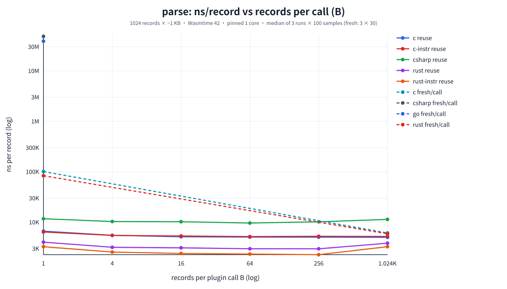
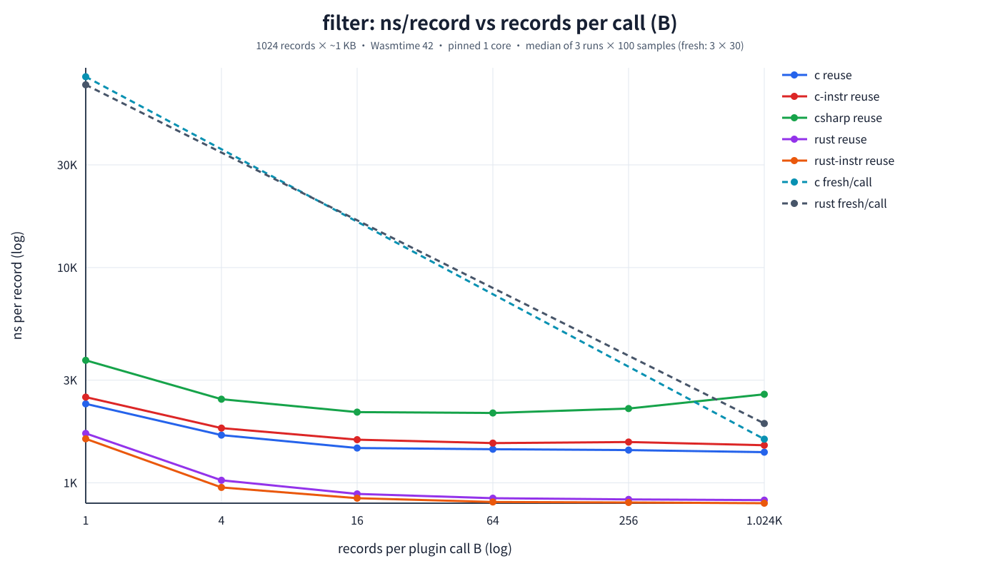
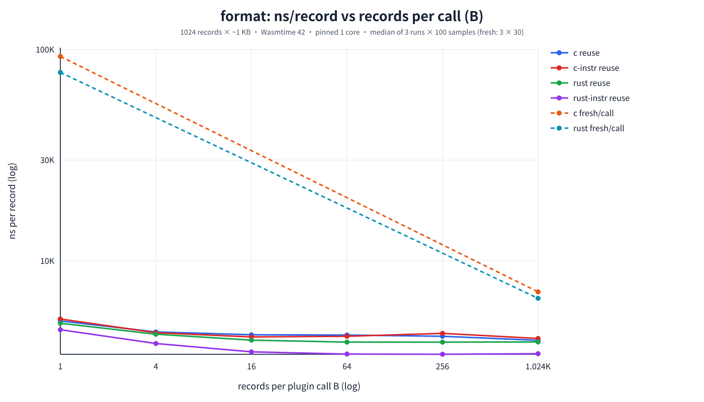
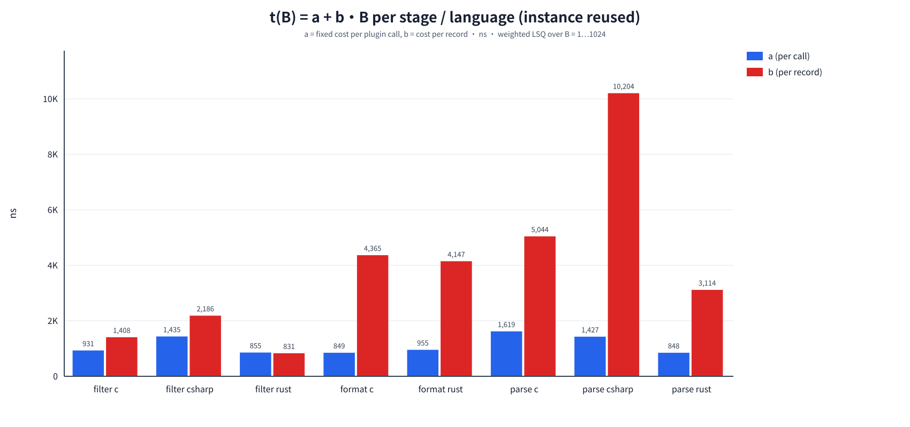
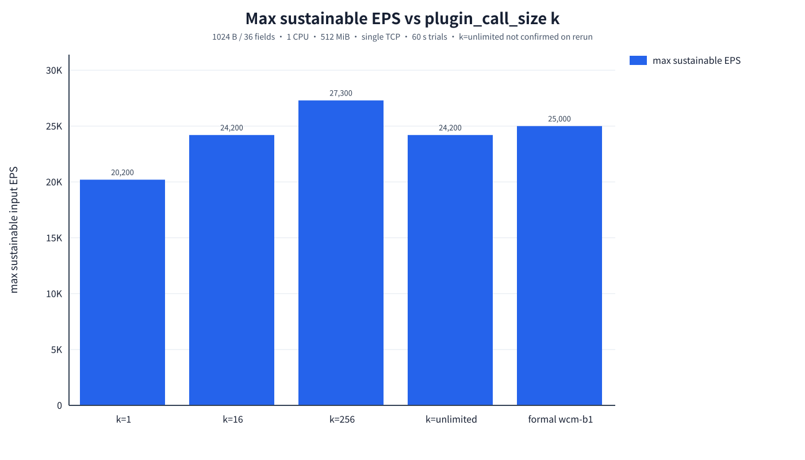
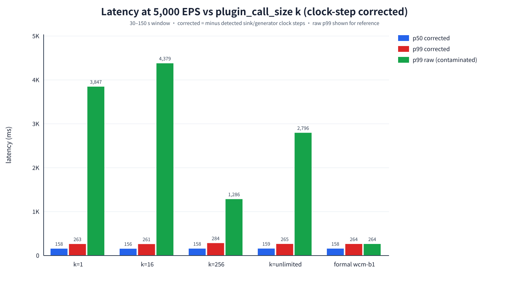
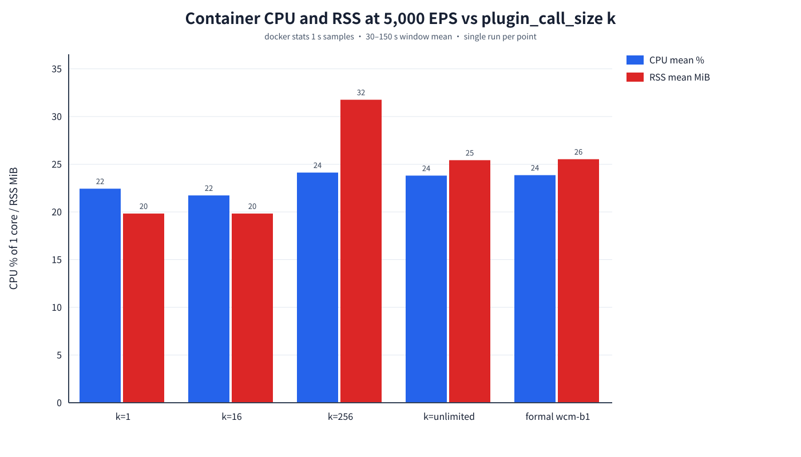
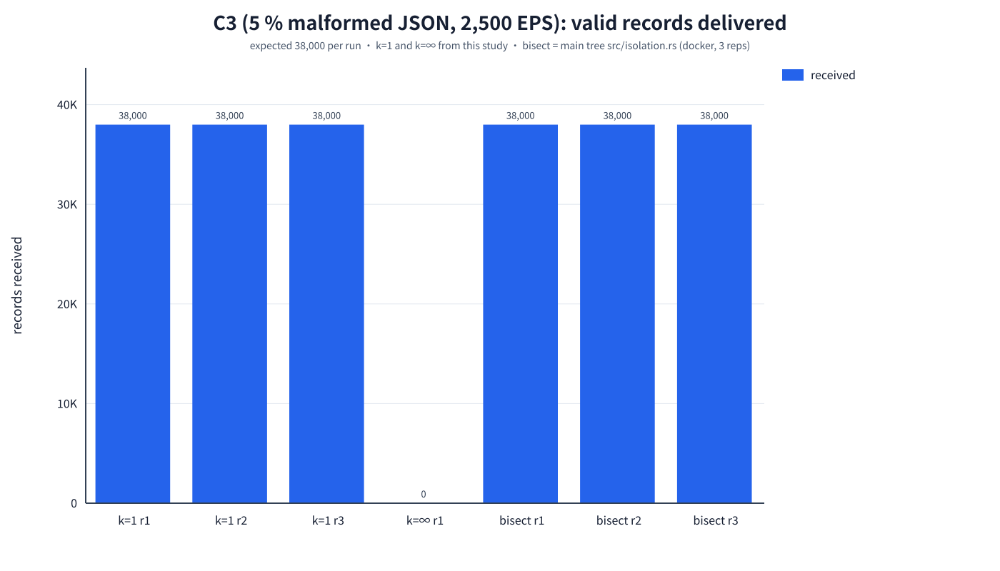

# 逐筆呼叫（per-record invocation）研究

**問題**：WCM 的 Parse／Filter／Format plugin 目前每次呼叫處理一整個 batch。如果改成「每次呼叫只帶 1 筆、instance 重用」，或每次帶 k 筆，成本是多少？這樣做能不能換到逐筆錯誤隔離？能不能讓 WCM 的行為和其他產品「對齊」？

本研究分兩層量測：
- Part A：micro benchmark，量單一 plugin 的呼叫邊界成本。
- Part B：系統層，以 1 CPU、512 MiB 容器量測容量、延遲與 C3 正確性。

所有量測都已經完成。本文件只整理既有資料並加以分析，沒有重跑任何量測。

---

## 0. 結論摘要

| 問題 | 答案 |
|---|---|
| 1. 逐筆呼叫（instance 重用）的成本 | **Micro**：每筆多約 0.8–1.6 µs（Rust／C），C# 約 1.6–2.1 µs。Filter 的單筆工作量最小，因此 B=1 時每筆成本變成約 2 倍（+67～104%）。Parse 與 Format 則多 +22～36%。**系統層**：k=1 的容量從 24,200 降到 20,200 EPS（相對 k=unlimited 為 −16.5%，相對正式 wcm-b1 的 25,000 為 −19.2%），等於每筆多約 8.2 µs CPU。5,000 EPS 時，校正時鐘後 k=1 的 p99 是 263.5 ms，和整批（265.2 ms）及正式值（263.959 ms）沒有差別。 |
| 2. Crossover（成本落在整批的 5–10% 以內的最小 k） | **Micro**：在最佳 B 的 10% 以內需要 B≈4–16，5% 以內需要 B≈16（Filter Rust 要 64）。**系統層**：k=16 的容量 = 24,200 EPS，與 k=unlimited 相同（0%），相對 25,000 為 −3.2%。所以 **k=16 已達到整批水準**。k 介於 1 和 16 之間沒有量測。 |
| 3. 原因 | 成本可分成兩項：每次呼叫的固定成本 a（Component Model 的 lift/lower、進出 guest、epoch deadline、host 端組裝結果）約 0.85–1.6 µs，每筆成本 b 約 0.8–10 µs。當 a 和 b 同一數量級（Filter），B=1 時成本會翻倍；當 b ≫ a（Parse／Format），影響約 20–35%。只要 B ≥ 20·a/b（約 5–20 筆），a 就被攤到 5% 以下。系統層的額外成本（約 8.2 µs/筆）大約是 micro 的 a 加總（約 2.3 µs/筆）的 3.5 倍，多出來的部分應來自 host 端每次子呼叫的處理路徑，這點沒有另外 profile。 |
| 4. 能否與其他產品「對齊」？ | **不能。** k=1、16、256、unlimited 在 5,000 EPS 下校正後的 p50 都約 156–159 ms，p99 都約 261–284 ms，與整批相同。延遲由 host 的 batch 累積（1 MiB buffer／1 s max_wait）決定，與 plugin 一次處理幾筆無關。其他產品的延遲同樣由 flush 間隔決定：Fluent Bit 為 1 s flush，p99 約 1,013 ms，改成 Flush=0.01 後為 29 ms；Fluentd 為 480 ms；Vector 為 523 ms。逐筆呼叫只改變「每次呼叫帶幾筆」，不改變「每批何時送出」。 |
| 5. 錯誤隔離建議 | **預設採用「整批呼叫，出錯時才在 host 端 bisection」（`src/isolation.rs`）**。無錯誤時它的成本是零，C3 三輪都是 38,000/38,000。若錯誤率高到幾乎每批都有錯，可改用 **k=16** 作為上限。**k=1 不建議作為預設**，因為它在無錯時也要付出 −16.5% 的容量。長期最乾淨的作法是 **per-record WIT result 型別**：一次呼叫就能得到逐筆結果，不必重試，但需要改 WIT 和所有 plugin。詳見 §5.5。 |

---

## 1. 方法

### 1.1 Host 修改（`host_change.patch`）

在 `batch:` 下新增 `plugin_call_size: k`。省略或設為 0 時維持原行為（整批一次呼叫）；k>0 時，host 照常累積並 flush batch，只是把每個 batch 切成最多 k 筆的子呼叫，並在**同一個 instance** 上依序呼叫（`run_subcalls`）。parse 子呼叫回傳 plugin error 時，只丟棄該段，instance 繼續使用；遇到 trap 時換新 instance 並重試。這段修改只存在於 worktree 的工作目錄（未 commit），`host_change.patch` 與 `git diff -- src` 逐位元組相同。

### 1.2 Part A：micro（`micro/`，`scripts/run_micro.sh`）

- Harness `micro/src/main.rs`：Wasmtime 42.0.1，Engine、Store、ResourceLimiter、WasiCtx 與 epoch deadline 的設定都和 forwarder 相同，使用正式 WIT 與正式 plugin `.wasm`。
- 輸入為 1024 筆、每筆約 1 KB。parse 使用 1024 B JSON（4 個欄位）；filter／format 使用 LogEntry（message 917 B），fixture 與 `test/ours/copy_overhead` 相同。
- 呼叫大小 B ∈ {1, 4, 16, 64, 256, 1024}，每次呼叫帶 B 筆，共呼叫 1024/B 次。
- 三種模式：
  - `reuse`：一個 instance 連續呼叫，即本研究要評估的作法。
  - `fresh-pre`：每次呼叫都新建 Store，並以 InstancePre 實例化。
  - `fresh-link`：每次呼叫都以 Linker 完整實例化。
- 語言：Rust、C、C#，以及 `*-instr`（copy_overhead 的 instrumented 版本，可拆出 copy-in、guest、copy-out）。Go 只有部分資料，見 §7。
- 執行條件：`taskset` 釘在 CPU 2，3 runs。每個 run 的 reuse 為 100 rounds（warmup 10），C# 為 30 rounds，fresh 為 30 rounds。統計值取同一組合所有樣本的中位數。
- 擬合模型為 t(B) = a + b·B，t 是每次呼叫的時間。以相對誤差加權最小平方法（權重 1/t²）求解，所以 a 是每次呼叫的固定成本，b 是每筆成本。

### 1.3 Part B：系統層（`system/`，`scripts/system_all.sh`）

執行順序與輸出位置：

| 步驟 | 指令 | 輸出 |
|---|---|---|
| 1. C3 | `correctness_percall.sh`：k=1 跑 3 輪，k=unlimited 跑 1 輪 | `system/correctness/c3_k1/C3_rep{1,2,3}`、`c3_kinf/C3_rep1` |
| 2. 容量搜尋 | `search_percall.sh`：依 kinf(12500) → k1(3125) → k16(12500) → k256(12500) 的順序 | `system/runs/wcm-percall-*/cap_rate_*`、`search_result.txt` |
| 3. 5,000 EPS 延遲 | `latency_percall.sh <dut> 5000`，四個變體 | `system/runs/wcm-percall-*/lat_rate_5000_fields1k_latency_cgroup/` |

- 共同條件與正式 wcm-b1 相同：1024 B／36 欄位 JSON、1 CPU、512 MiB、單一 TCP 連線、1 MiB buffer、`max_wait_ms: 1000`、單一 transport worker、Rust plugin（`test/ours/latency-benchmark-Rust/plugin`）。
- Image 為 `wcm-base-log-forwarder:percall`（`sha256:6d353b60…`），所有 run 的 `image.txt` 都相同。
- 容量判定沿用正式的 `eval_trial.py`：每個 trial 60 s，要求 gen 沒有被卡住（avg ≥ 99.5%，send-lag p99 ≤ 10 ms），且 backlog ≤ 3×rate。搜尋時在容量點會重跑一次確認。
- 延遲量測為 180 s 負載，取第 30–150 s 的窗口。CPU 與 RSS 取自 docker stats，每 1 s 一筆樣本。

### 1.4 延遲資料的時鐘階梯問題與校正（重要）

`system_all.log` 每個 run 都警告「時鐘狀態異常 clocksource=tsc timesyncd=inactive」，而且腳本以 `SKIP_CLOCK_CHECK=1` 執行。原始延遲出現了**階梯式上升**（`system/system_latency_timeline.csv`）：

- 每 30–40 s，「每 10 s 最小延遲」整段抬高 600–1,200 ms，之後維持不變。在這段期間，吞吐固定為 5,000 EPS，backlog 約為 0，CPU 只用了約 23%。
- 真正的排隊延遲會在 CPU 有餘裕時消退，不會維持一個永久偏移。因此這是**時間基準的跳躍**，不是 DUT 變慢。generator 的 ts 由 start_wall 加上排程偏移得出，不受 wall clock 跳躍影響；sink 則用 `time.Now()`，會受影響。
- 同一個現象已記錄在 `test/compare/batch_alignment/PROGRESS.md`：WSL2 的 tsc clocksource 下，wall clock 約每 32 s 向前跳一次。

本研究的四次 5,000 EPS run 都沒有記錄 `clock_drift.csv`，所以 `scripts/analyze_followup.py` 改從資料本身偵測階梯：

1. 若 1 s bin 最小延遲的相鄰差 > 400 ms，就視為一次階梯。
2. 每段的水準取該段 bin 最小值的中位數，offset = 該段水準 − 第一段水準。
3. 每筆記錄指派到滿足 offset ≤ 延遲 − 10 ms 的最大段，再扣掉該段的 offset。這個方法的前提是自然延遲範圍（約 20–370 ms）小於最小階梯（本資料 ≥ 600 ms）。

**驗證**：
- 校正後每 10 s 的中位數都平坦落在 150–165 ms（見 timeline CSV）。
- 對正式 wcm-b1 跑同一支程式，結果是 p50 158.4 ms、p99 264.0 ms，與正式值相同。它唯一偵測到的「階梯」在 t=180 s 的 drain 期，位於統計窗口之外。
- 每個 run 在第一次階梯前的乾淨窗口（未校正）與校正後的值一致。例如 kinf 的 10–57 s 為 p99 264.0 ms，校正後為 265.2 ms；k256 的 10–93 s 為 279.2 ms，校正後為 284.0 ms。

offset 的估計誤差約 ±10 ms。**原始的 30–150 s 統計值（`system_latency.csv`、`system_p99_vs_k.svg`）已被污染，不可使用。** 容量判定主要依據計數與 send-lag，60 s trial 受到的影響較小，但 backlog 的計算混用了 wall 時刻，判定可能因此稍微放寬約 1 s。

---

## 2. Part A：micro 結果

### 2.1 ns/record vs B（instance 重用，中位數；最後一欄為每次呼叫新 instance 的 B=1）

| stage | lang | B=1 | 4 | 16 | 64 | 256 | 1024 | fresh-pre B=1 |
|---|---|--:|--:|--:|--:|--:|--:|--:|
| parse | rust | 4,029 | 3,185 | 3,110 | 2,977 | **2,971** | 3,839 | 83.5 µs |
| parse | c | 6,644 | 5,502 | 5,144 | 5,067 | 5,055 | **5,010** | 100.9 µs |
| parse | csharp | 11,726 | 10,327 | 10,212 | **9,623** | 10,178 | 11,384 | 48.1 ms |
| filter | rust | 1,697 | 1,028 | 888 | 849 | 838 | **831** | 70.6 µs |
| filter | c | 2,328 | 1,667 | 1,452 | 1,432 | 1,420 | **1,389** | 77.0 µs |
| filter | csharp | 3,708 | 2,446 | 2,130 | **2,111** | 2,215 | 2,580 | – |
| format | rust | 5,067 | 4,496 | 4,216 | 4,126 | **4,124** | 4,132 | 78.0 µs |
| format | c | 5,197 | 4,610 | 4,469 | 4,456 | 4,397 | **4,207** | 92.7 µs |

粗體為最佳的 B。完整資料（含 `*-instr`、run 間範圍、fresh-link、fresh B=1024）在 `micro/analysis/micro_ns_per_record_tidy.csv`。

圖：`micro/analysis/micro_parse_ns_per_record_vs_B.svg`、`micro_filter_ns_per_record_vs_B.svg`、`micro_format_ns_per_record_vs_B.svg`（實線為 reuse，虛線為 fresh），以及 `micro_extra_cost_pct_vs_B.svg`。





觀察：
- **重用 instance 與每筆新建 instance 差了 15–25 倍。** fresh-pre B=1 為 70–100 µs/筆（Rust／C），C# 為 48 ms/筆。因此「逐筆呼叫」只在 instance 重用時才有討論空間。先前提到「C# 每次呼叫約 34–38 ms 固定成本」，指的是**實例化**成本（本資料 fresh-pre 約 48 ms/次）。instance 重用時，C# 的 a 只有約 1.4–1.8 µs。
- **Parse Rust 與 C# 在 B=1024 時反而比 B=64–256 慢 18–29%。** 以 Rust parse 為例，wasm 記憶體峰值從 B=256 的 1.7 MB（grow 10 次）升到 B=1024 的 3.5 MB（grow 37 次）。輸出 list 的工作集與 memory.grow 讓大批次的每筆成本上升。所以「相對 B=1024」會低估逐筆呼叫的成本，下文一律以「相對最佳 B」比較。
- Instrumented 拆解顯示，copy-in 的固定部分約 0.37–0.48 µs/次，約占 a 的一半（`micro_fit.csv` 的 `copy_in_a_ns`）。

### 2.2 t(B) = a + b·B 擬合（instance 重用）

| stage | lang | a（ns/次） | b（ns/筆） | a/b（筆） | 20a/b（5% 門檻） | 最大相對殘差 | B=1 相對最佳 B | 實測 5% 以內最小 B | 實測 10% 以內最小 B |
|---|---|--:|--:|--:|--:|--:|--:|--:|--:|
| parse | rust | 848（B≤256：1,038） | 3,114（2,977） | 0.27 | 5.4 | 18.9%（B≤256：<1%） | +35.6% | 16 | 4 |
| parse | c | 1,619 | 5,044 | 0.32 | 6.4 | 1.0% | +32.6% | 16 | 4 |
| parse | csharp | 1,427（B≤256：1,790） | 10,204（9,928） | 0.14 | 2.8 | 10.4% | +21.9% | 64 | 4 |
| filter | rust | 855 | 831 | 1.03 | 20.6 | 1.7% | +104.2% | 64 | 16 |
| filter | c | 931 | 1,408 | 0.66 | 13.2 | 1.6% | +67.6% | 16 | 16 |
| filter | csharp | 1,435（B≤256：1,571） | 2,186（2,099） | 0.66 | 13.1 | 15.2% | +75.7% | 16 | 16 |
| format | rust | 955 | 4,147 | 0.23 | 4.6 | 2.5% | +22.9% | 16 | 4 |
| format | c | 849 | 4,365 | 0.19 | 3.9 | 3.8% | +23.5% | 256* | 4 |

- 來源：`micro/analysis/micro_fit.csv`（所有 B）與 `micro_fit_le256.csv`（只用 B≤256，避免 B=1024 的非線性退化）。圖：`micro_fit_a_b.svg`。
- \* format C 的 run 間差距大（B=16–256 的 run 中位數範圍約 ±10%），「5% 以內」的判定受雜訊左右。B=4 已在 10% 以內。



**重點**：a 的值在不同 stage 和語言之間差異不大（Rust／C 約 0.85–1.6 µs，C# 約 1.4–1.8 µs），反映的是 Component Model 邊界與 host 呼叫路徑的成本。b 才是 plugin 本身的工作量。B=1 的相對成本 ≈ a/b，因此 Filter 受害最嚴重（a≈b），Parse 和 Format 較輕（a≈0.2–0.3b）。

---

## 3. Part B：系統層結果

### 3.1 最大可持續 EPS vs k

| k | 容量（EPS） | 第一個 FAIL | 確認 | 相對 k=unlimited | 相對正式 25,000 | 1 CPU 下每筆 CPU 時間 |
|---|--:|--:|---|--:|--:|--:|
| 1 | **20,200** | 21,000 | 重跑 PASS | **−16.5%** | −19.2% | 49.5 µs |
| 16 | **24,200** | 25,000 | 重跑 PASS | 0.0% | −3.2% | 41.3 µs |
| 256 | **27,300** | 28,100 | 重跑 PASS | +12.8% | +9.2% | 36.6 µs |
| unlimited | **24,200** | 25,000 | **重跑 FAIL**（24,200 第二次 FAIL） | – | −3.2% | 41.3 µs |
| 正式 wcm-b1 | 25,000 | 25,500 | 3 輪 | – | – | 40.0 µs |

來源：`system/system_capacity.csv`、`system_trials.csv`、`system_summary_vs_k.csv`。圖：`system/system_capacity_vs_k.svg`。



- k=unlimited 在本研究 image 上的容量點沒有通過確認。真實容量應在 23,400–24,200 之間，與正式值 25,000 相差 3–6%。這個差距可以視為**系統層容量的雜訊尺度**（不同日期、同一台機器、同一份設定）。
- 依此尺度：k=16 與 k=unlimited 無法區分；k=1 的 −16.5% 明顯超出雜訊；k=256 的 +12.8% 也超出雜訊，方向和 micro 一致（Parse Rust 在 B=256 時比 B=1024 快 22.6%）。不過 k=256 只做過一次搜尋，而且它的增益（約 4.7 µs/筆）大於 micro 能解釋的部分（約 0.9 µs/筆），因此只能保守地說「k=256 至少不比整批差」。

### 3.2 5,000 EPS 延遲、CPU、RSS vs k（校正時鐘後）

| k | p50 校正 | p99 校正 | p99.9 校正 | 原始 p50／p99（已污染） | 偵測到的時鐘階梯 | CPU mean | RSS mean／max |
|---|--:|--:|--:|--:|---|--:|--:|
| 1 | 157.7 ms | **263.5 ms** | 294.7 ms | 2,767／3,847 ms | 7 次，共 6.3 s | 22.4% | 19.8／20.6 MiB |
| 16 | 156.1 ms | **261.4 ms** | 288.5 ms | 2,297／4,379 ms | 5 次，共 5.4 s | 21.7% | 19.8／20.4 MiB |
| 256 | 158.3 ms | **284.0 ms** | 324.3 ms | 257／1,286 ms | 2 次，共 1.8 s | 24.1% | 31.8／32.9 MiB |
| unlimited | 159.3 ms | **265.2 ms** | 297.5 ms | 1,037／2,796 ms | 5 次，共 4.3 s | 23.8% | 25.4／29.5 MiB |
| 正式 wcm-b1 | 158.4 ms | 263.959 ms | 295.4 ms | 同左 | 窗口內無 | 23.9% | 25.5／29.4 MiB |

來源：`system/system_latency_corrected.csv`、`system_latency_timeline.csv`、`system_latency.csv`（原始）。圖：`system/system_latency_vs_k.svg`、`system_cpu_rss_vs_k.svg`。




- 校正後，四個 k 的延遲分佈與正式 wcm-b1 幾乎相同。p50 約 158 ms，大約是 1 MiB buffer 在 5 MB/s 下填滿所需的時間（約 0.2 s）的一半。k=256 的 p99 高出約 20 ms，這是單一 run，而且在乾淨窗口內（未校正）也是 279 ms，可能是真實現象，也可能是雜訊，目前無法判斷。
- 5,000 EPS 下 CPU 都在 22–24%。依容量推算，k=1 每筆多 8.2 µs，在 5,000 EPS 下約等於多 4% CPU，但實測反而略低。這說明在 1 s 取樣、單一 run 的條件下，±2% 的 CPU 差異量不出來。低負載時 CPU 不是有效的區分指標。
- RSS：k=1 和 k=16 比整批少約 5.6 MiB，原因是每次呼叫的輸入與輸出 list 較小，wasm 線性記憶體不需要長大。k=256 反而較高（31.8 MiB），原因不明（單一 run）。

---

## 4. C3 正確性（5% malformed JSON，2,500 EPS，100,000 筆輸入，預期送達 38,000 筆）

| 變體 | 輪數 | 送達 | missing | dup／corrupt／reorder | 被拒記錄 | parse plugin 呼叫總數 | run 期間 CPU 秒 | RSS max |
|---|--:|--:|--:|---|--:|--:|--:|--:|
| **k=1**（本研究） | 3 | **38,000 / 38,000**（3/3 PASS） | 0 | 0／0／0 | 5,000（只有 malformed） | 100,000 | 8.09／4.69／4.76 | 40.0／39.0／19.8 MiB |
| **k=unlimited**（本研究，無隔離） | 1 | **0 / 38,000**（FAIL） | 38,000 | 0／0／0 | 99 個 batch 全部丟棄 | 99 | 1.06 | 13.1 MiB |
| 整批 + host bisection（主樹 `src/isolation.rs`，docker） | 3 | **38,000 / 38,000**（3/3 PASS） | 0 | 0／0／0 | 5,000 | 約 52,400（每個錯誤 batch 約 528 次） | 7.51／7.40／7.80 | 33.2／30.8／30.7 MiB |
| 整批 + bisection（native，無 cgroup） | 3 | 38,000 / 38,000 | 0 | 0 | – | – | – | – |

來源：`system/system_c3_compare.csv`、`system/system_correctness.csv`；`test/compare/correctness/runs/isolation_docker_20261014_002704`、`native_isolation_c1c3c4/summary.md`。圖：`system/system_c3_received.svg`。



- 沒有任何隔離時，**每個 batch 都含有 malformed 記錄**（5% × 1024 ≈ 51 筆），因此 99 個 batch 全部被丟棄。這與正式 wcm-b1 先前三輪 0/38,000 的結果一致。
- k=1 和 bisection 都完整救回所有合法記錄，而且沒有重複、損毀或亂序。
- 在 5% 錯誤率下，bisection 每個 batch 要多呼叫約 528 次，而且同一筆記錄會在多層中被重複 parse。它的 CPU（約 7.5 s）不比 k=1 低（rep2/3 約 4.7 s，rep1 為 8.1 s 屬離群值）。兩者來自不同 image、不同日期，數值只能看數量級。這是 bisection 的最壞情況。無錯誤時，bisection 完全不會觸發，成本為 0。對照組 C1（合法資料）在同一個 isolation image 上為 5.3 s／40,000 筆。

---

## 5. 問題回答

### 5.1 逐筆呼叫（instance 重用）的成本多大？

- **Micro**：每次呼叫的固定成本 a ≈ 0.85–1.6 µs（Rust／C），C# 約 1.4–1.8 µs。B=1 相對最佳 B 的額外成本：Filter +68～104%、Parse +22～36%、Format +23%。
- **系統層**：k=1 的容量降低 16.5%（24,200 → 20,200 EPS），等於每筆多 8.2 µs CPU。低負載（5,000 EPS）時延遲和 CPU 都沒有可量測的差異。RSS 反而少約 5.6 MiB。
- **每筆新建 instance**：每筆 70–100 µs，C# 和 Go 約 40–48 ms。這種作法完全不可行。

### 5.2 Crossover

- **Micro**：B=16 時，大多數 stage 和語言都落在最佳值的 5% 以內（Filter Rust 和 Parse C# 要 64）。模型 20a/b 給出的門檻是：Parse 和 Format 約 3–6 筆，Filter 約 13–21 筆。
- **系統層**：**k=16 時容量與整批相同（24,200 = 24,200，相對正式值 −3.2%，在雜訊範圍內）**；k=1 為 −16.5%。所以達到整批 5–10% 以內的最小 k **≤ 16**。k=2–8 沒有量測。若把 micro 的 a/k 依 k=1 的系統放大倍率（約 3.5 倍）粗估，k=4 時每筆約多 2 µs，容量約為 −5%（推估值，未量測）。

### 5.3 為什麼？

每次呼叫的時間是 a + b·B，每筆的成本是 a/B + b。
- **a（固定成本）**：Component Model 的 lift/lower 呼叫框架（instrumented 版本中 copy-in 的固定部分約 0.4–0.5 µs）、進出 guest、`set_epoch_deadline`、host 端建立參數與回收結果的 Vec 等。a 與 stage 和語言大致無關。
- **b（每筆成本）**：plugin 實際的 JSON parse、過濾與格式化工作，加上與資料量成正比的 copy。
- B=1 時每筆成本變為 a + b，相對成本約為 a/b：Filter 約 0.7–1.0，Parse 和 Format 約 0.2–0.3。B ≥ 20a/b 時，a 就攤到 5% 以下。
- 系統層的額外成本（8.2 µs/筆）大於 micro 三個 stage 的 a 加總（Parse 1.06 + Filter 0.87 + Format 0.94 × 38% 通過率 ≈ 2.3 µs/筆）。差距約 3.5 倍，推測來自 forwarder 每次子呼叫的 host 路徑：`run_subcalls` 的結果 Vec、逐段組裝 `ParsedBatch`，以及在單一 CPU 上與 tokio、transport 共用時 cache 與分支預測被打亂。這部分**沒有 profile**，屬於推論。
- 反過來看，batch 太大也不好：Parse Rust 和 C# 在 B=1024 時記憶體工作集較大，而且需要 memory.grow，每筆成本上升 18–29%。這可能是 k=256 系統容量較高的部分原因。

### 5.4 逐筆呼叫是否讓 WCM 與其他產品「對齊」？

**不會。** 理由有兩個：
1. 逐筆呼叫只改變 host 把一個 batch 交給 plugin 的方式。batch 何時形成、何時送出，仍由 1 MiB buffer 和 1 s max_wait 決定。資料顯示 k=1 的延遲分佈（校正後 p50 157.7 ms、p99 263.5 ms）與整批（159.3／265.2 ms）及正式值（158.4／263.959 ms）幾乎完全相同。
2. 其他產品的 5,000 EPS 端到端延遲同樣由 output flush 和 batching 主導（`test/compare/results/*_fields1k_latency_*_sweep.csv`、`test/compare/batch_alignment/method3_latency_5000eps.csv`）：Fluent Bit Lua 在 1 s flush 下 p99 為 1,012.8 ms，Flush=0.01 時為 29.5 ms；Fluent Bit WASM 為 1,019.8 ms；Fluentd 為 480.3 ms；Vector 為 523.1 ms。它們的 filter 雖然逐筆執行，延遲仍然是 flush 間隔的函數。

真正能「對齊」的參數是 flush 和 batch 的條件（buffer 大小、max_wait、output 的 batch 上限），這屬於 `test/compare/batch_alignment` 的研究範圍，與 plugin 的呼叫粒度無關。逐筆呼叫唯一確實改變的行為是**錯誤隔離的粒度**。

### 5.5 錯誤隔離四種作法的建議

| 作法 | 無錯誤時的成本 | 有錯誤時 | 實作成本 | 評價 |
|---|---|---|---|---|
| A. 逐筆呼叫（k=1） | **−16.5% 容量**（一直都要付） | 隔離粒度最細，C3 為 38,000/38,000 | 小（已實作為 patch） | 為了少見的錯誤而一直付出代價，不建議作為預設 |
| B. 小 k（例如 16） | 約 0%（在雜訊內） | 一筆錯誤會丟掉同一個子呼叫內最多 k−1 筆好記錄（除非再對該段做 bisection） | 小（同一個 patch） | 可作為「保底」：限制單次錯誤的影響範圍，幾乎不損失容量 |
| C. 整批呼叫，出錯才在 host 端 bisection（`src/isolation.rs`） | **0** | C3 為 38,000/38,000。5% 錯誤率時每個錯誤 batch 約 528 次額外呼叫，CPU 約 7.5 s，與 k=1 同一數量級 | 已在主樹實作並驗證（native 與 docker 各 3 輪） | **建議作為預設** |
| D. per-record WIT result（`list<result<entry, error>>`） | 約 0（仍是整批呼叫） | 一次呼叫就得到逐筆結果，不需要重試或重複 parse | 大：要改 WIT 和所有語言的 plugin，trap 仍需 host 處理 | 長期最乾淨的作法，適合下一版 WIT |

**建議**：
- 預設使用 **C（bisection）**，因為無錯時成本為 0，有錯時能完整救回合法記錄。
- C 的弱點是高錯誤率：每個 batch 都有錯時，它會退化成大量重複呼叫。目前 `isolation.rs` 只為 trap 設定呼叫次數和深度的上限，plugin Err 的二分沒有上限（最壞 2n−1 次呼叫、O(n log n) 的 parse 量）。可以考慮新增一條規則：區段縮小到約 16 筆以下時，改成逐筆呼叫，避免同一筆記錄在多層中被重複 parse。或者在某個來源的錯誤率持續偏高時，對該來源改用 **B（k=16）**，再對失敗的段落做逐筆處理，以控制最壞情況的成本。這兩項都是建議，尚未實作。
- 若之後要改 WIT，應採用 **D**，讓 plugin 直接回報逐筆結果。這樣既能維持整批呼叫的效率，又不必重試。trap 屬於 instance 失效，仍需要 host 換 instance 後重試（C 的機制）。
- **A（k=1）不建議作為常態設定**。它是唯一在無錯時也付出明顯代價的作法，而且延遲並沒有因此改善。

---

## 6. 重複次數與雜訊（請讀）

- **Micro**：每個組合跑 3 runs，每個 run 30–100 個樣本，數值取中位數。run 間中位數的差距通常在 ±5% 以內，但 Format C 和部分 C# 組合可達 ±10–15%。因此 5% 等級的 crossover 判定（例如 Format C 的「256」）不穩定，10% 等級的判定比較可靠。C# 的曲線不是單調的（B=1024 比 B=64 慢 18%），所以 C# 的 a、b 擬合殘差達 10–15%。
- **系統層容量**：每個 k 只做了**一次**二分搜尋，只有容量點有重跑確認。k=unlimited 的確認失敗了（24,200 第一次 PASS、第二次 FAIL）。同一份設定與正式 3 輪結果（25,000）相差 3–6%，應把這當作容量的雜訊尺度。k=16 與 k=unlimited 的差距（0%）遠小於這個尺度；k=1 的 −16.5% 遠大於它。
- **系統層延遲與資源**：每個 k 只有**一次** 180 s run，原始延遲**全部受到時鐘階梯污染**，校正值的誤差約 ±10 ms。CPU 與 RSS 也只有單一 run。k=16 的那次 run 結束後主機曾暫停約 47 分鐘（sink 在 t≈1,400 s 和 3,030 s 才收到最後的記錄，all-run p99 因此變成 2,858 s），這發生在統計窗口之外，不影響 30–150 s 的結果。
- **C3**：k=1 跑 3 輪，k=unlimited 只跑 1 輪（正式 wcm-b1 已有 3 輪 0/38,000 可以佐證）。bisection 的對照來自主樹另一個 image、另一個日期，CPU 秒數只能比較數量級。

---

## 7. 缺漏與不一致

1. **Go（TinyGo）micro 不完整**：reuse 模式在 B=64 時 trap（`main.skipJSONSpace` out of bounds memory access），3 runs 都一樣，只有 B=1／4／16 的部分資料（`micro/analysis/micro_go_partial.csv`：158 µs、40 µs、5.6 µs／筆）。fresh-pre B=1 約 38.7 ms／筆。Go plugin 在重用 instance 並多次呼叫後會損毀記憶體，這是 plugin 的 bug，與呼叫粒度無關，但它說明 instance 重用時 plugin 必須能承受多次呼叫。
2. **C parse plugin 在重用時記憶體持續成長**：wasm 記憶體峰值約 119 MB，grow 約 1,800 次，而且所有 B 都一樣，看起來每筆都在洩漏。長時間重用 instance 時會碰到 128 MiB 的 ResourceLimiter 上限。
3. **`reproduce.sh` 的 `system-lathigh` 步驟（HIGH_RATE=15000）沒有執行**，`system_all.sh` 也不包含這一步，因此沒有高負載下的延遲資料。
4. **原始延遲已被污染**（§1.4）。`system_latency.csv` 與 `system_p99_vs_k.svg` 僅保留作為原始紀錄，應改用 `system_latency_corrected.csv` 與 `system_latency_vs_k.svg`。
5. **k=unlimited 的容量沒有通過確認**（見 §3.1）。
6. **與先前邊界成本數字不一致**：先前的 WCM batch 1024 數據為 Parse 4.399 ms、Filter 1.945 ms、Format 14.833 ms。本研究 B=1024 reuse 的結果為 Parse Rust 3.93 ms、Filter 0.85 ms、Format 4.23 ms（instrumented 版本為 3.35、0.82、3.72 ms）。Parse 接近，Filter 和 Format 差了 2.3–3.5 倍。兩者的 harness、fixture 或模式（例如是否包含實例化）可能不同。本研究沒有重跑舊的 harness，因此無法確定原因，引用時不應混用。
7. Micro 的 parse fixture 是 4 個欄位的 1 KB JSON，系統層是 36 個欄位的 1 KB JSON，所以 micro 的 b 不能直接換算成系統層的每筆成本。
8. `test/compare/correctness/runs/native_isolation_c1c3c4/summary.md` 的結論文字寫著「every contaminated batch was discarded」，與表格（38,000/38,000）矛盾。這段文字疑似是從無隔離版本沿用的舊句子，請以表格和 `validation_summary.json` 為準。

---

## 8. 檔案

- `README.md`：本文件。
- `host_change.patch`：host 修改（`plugin_call_size`），與 worktree 的 `git diff -- src` 相同。
- `environment.txt`：OS、toolchain、image ID、plugin 與 harness 的 sha256。
- `reproduce.sh`：從建置到分析的全部步驟。
- `scripts/`：
  - 量測：`run_micro.sh`、`build_micro.sh`、`system_all.sh`、`search_percall.sh`、`capacity_percall.sh`、`latency_percall.sh`、`correctness_percall.sh`、`Dockerfile.percall`、`make_yaml.py`、`collect_env.sh`、`locked_cargo.sh`、`smoke_native.sh`
  - 分析：`analyze_micro.py`、`analyze_system.py`、`analyze_followup.py`（本次新增）、`svgplot.py`
- `micro/`：harness 原始碼（`src/main.rs`、`wit/`、`plugins/parser_c_json.wasm`）。`results/formal/` 是原始 CSV 與 log，`analysis/` 是彙整後的 CSV 與 SVG：
  - `micro_summary.csv`、`micro_ns_per_record_tidy.csv`：(a) ns/record vs B，reuse／fresh
  - `micro_fit.csv`、`micro_fit_le256.csv`：(b) a、b 擬合
  - `micro_go_partial.csv`
  - `micro_{parse,filter,format}_ns_per_record_vs_B.svg`、`micro_extra_cost_pct_vs_B.svg`、`micro_fit_a_b.svg`
- `system/`：`yaml/`、`runs/`（容量與延遲的原始資料）、`correctness/`（C3 原始資料）、`logs/system_all.log`，以及：
  - `system_capacity.csv`、`system_trials.csv`、`system_capacity_vs_k.svg`：(c)
  - `system_latency_corrected.csv`、`system_latency_timeline.csv`、`system_summary_vs_k.csv`、`system_latency_vs_k.svg`、`system_cpu_rss_vs_k.svg`：(d)
  - `system_latency.csv`、`system_p99_vs_k.svg`：原始延遲，已污染
  - `system_correctness.csv`、`system_c3_compare.csv`、`system_c3_received.svg`：(e)

---

## 9. 重現方式

### 9.1 程式碼與 image

- 程式碼：git worktree `/home/ckt1022/wcm-base-log-forwarder/.claude/worktrees/agent-a5fbec9d83acd8f7d`，branch **`worktree-agent-a5fbec9d83acd8f7d`**，base 為 `wit_test@1c4b9d4`（commit "experiment"）。host 修改在該 worktree 中**未 commit**，完整內容在 `host_change.patch`。如果在其他 checkout 上重現：

  ```bash
  git checkout 1c4b9d4            # wit_test@1c4b9d4
  git apply test/ours/per_record_invocation/host_change.patch
  ```

- Docker image：`wcm-base-log-forwarder:percall`
  - `docker image inspect --format '{{.Id}}' wcm-base-log-forwarder:percall` 的結果：
    **`sha256:6d353b60740d4033891be1c029302a9a3f3b6614cd7ee55163bb795d4f02db04`**（2026-10-14 記錄，與 `environment.txt` 以及每個 run 的 `image.txt` 相同）
  - 建置指令：`reproduce.sh build-image`，等同於在 repo 根目錄執行 `docker build -f test/ours/per_record_invocation/scripts/Dockerfile.percall -t wcm-base-log-forwarder:percall .`
- 唯讀依賴：主樹 `/home/ckt1022/wcm-base-log-forwarder` 的 `test-plugins/`、`test/ours/latency-benchmark-Rust/plugin`、`test/compare/capacity`、`test/compare/correctness`、`test/ours/copy_overhead`。sha256 見 `environment.txt`。

### 9.2 量測（全部在 `flock /home/ckt1022/.wcm-bench.lock` 內執行）

```bash
cd test/ours/per_record_invocation
./reproduce.sh                      # 依序執行全部步驟
# 或分步執行：
./reproduce.sh env build-host test-host build-image build-micro
./reproduce.sh micro                # CPU=2 RUNS=3 ROUNDS=100 WARMUP=10 → micro/results/formal
./reproduce.sh system-c3            # = scripts/system_all.sh c3
./reproduce.sh system-search        # = scripts/system_all.sh search
./reproduce.sh system-lat5000       # = scripts/system_all.sh lat5000
./reproduce.sh system-lathigh       # 本次未執行（見 §7）
```

注意：在 WSL2 的 clocksource=tsc 環境下，延遲會出現時鐘階梯。重跑時建議同時執行 `test/compare/batch_alignment/clock_drift_logger.py`，並用 `correct_latency.py` 校正；或者至少執行 `analyze_followup.py`，它會從資料本身偵測階梯。

### 9.3 分析（不需要 Docker，只讀既有資料）

```bash
cd test/ours/per_record_invocation
python3 scripts/analyze_micro.py micro/results/formal micro/analysis   # (a)(b)
python3 scripts/analyze_system.py .                                    # (c)、原始延遲、C3 彙整
python3 scripts/analyze_followup.py .                                  # 時鐘校正 (d)、B≤256 擬合、Go、C3 對照 (e)、圖
# 等同於 ./reproduce.sh analyze
```

`analyze_followup.py` 需要 numpy，並會讀取主樹的 `test/compare/capacity/runs/wcm-b1/lat_rate_5000_fields1k_latency_cgroup_rerun`（正式參考值）與 `test/compare/correctness/runs/isolation_docker_20261014_002704`（bisection 對照）。
